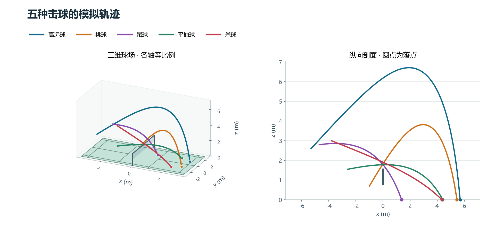
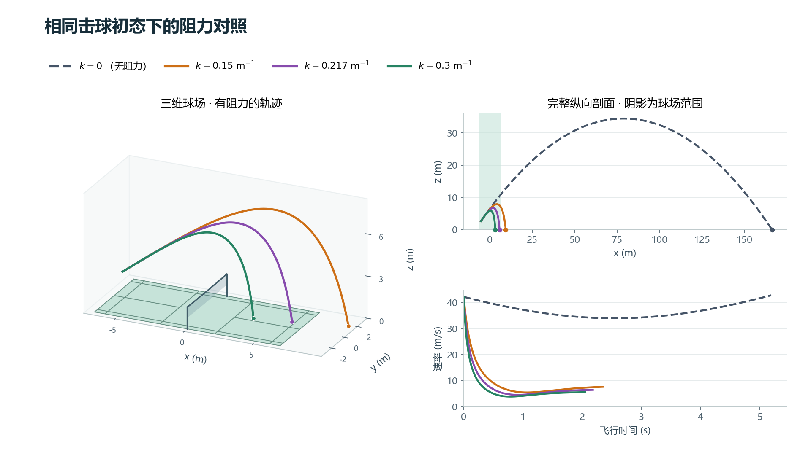

# 第二阶段 · 羽毛球三维自由飞行模拟

模拟器从离拍时的位置和速度出发，计算球心首次触地前的三维位置、速度、顶点和落点。本次在同一座标准球场上生成五种球路，并固定高远球的离拍条件比较四种阻力系数。全部初值为本阶段设定的模拟条件，参考系数来自项目计划。实验数据可以独立于第一阶段的视频运行。[初始条件](../configs/stage2-shots.json) · [逐时刻轨迹](../results/stage2/trajectories.csv) · [结果汇总](../results/stage2/summary.csv)

## 五种球路

取 $k=0.217$ m⁻¹，步长 0.01 s，从球网的负 $x$ 一侧击球。表中“过网余量”是球心穿过网平面时高出当地网顶的垂直距离。五个落点均位于对面单打区内。

| 球路 | 初速 (m/s) | 最高点高度 (m) | 过网余量 (m) | 飞行时间 (s) | 落点 $(x,y)$ (m) |
|---|---:|---:|---:|---:|---|
| 高远球 | 42.17 | 6.72 | 4.66 | 2.182 | (5.69, 0.96) |
| 挑球 | 18.98 | 3.82 | 0.30 | 1.692 | (5.46, −0.87) |
| 吊球 | 13.07 | 2.86 | 0.26 | 1.028 | (1.38, 1.17) |
| 平抽球 | 22.64 | 1.78 | 0.26 | 0.903 | (4.41, 1.45) |
| 杀球 | 51.40 | 3.00 | 0.39 | 0.515 | (4.35, −1.41) |

高远球和挑球都落在后场，挑球从网前 0.70 m 高处起飞，高远球则从后场 2.60 m 高处起飞。吊球落在距网约 1.38 m 的前场。杀球离拍时竖直速度已经朝下，表中的 3.00 m 最高点就是击球位置。



## 同一初态下的阻力对照

固定初始位置 $(-5.3,-1.7,2.6)$ m、初始速度 $(33,8,25)$ m/s。只改变 $k$，落点和顶点便有明显变化。取参考阻力时，球沿场长前进 10.99 m；取零阻力时，同样的初速让球沿场长前进 171.56 m。弱阻力示例的落点也超过了对面底线 $x=6.70$ m。

| $k$ (m⁻¹) | 飞行时间 (s) | 最高点高度 (m) | 落点 $x$ (m) | 触地速率 (m/s) |
|---:|---:|---:|---:|---:|
| 0 | 5.199 | 34.46 | 166.26 | 42.77 |
| 0.150 | 2.362 | 7.88 | 9.35 | 7.68 |
| 0.217 | 2.182 | 6.72 | 5.69 | 6.51 |
| 0.300 | 2.052 | 5.88 | 3.19 | 5.61 |



## 模型与几何

- **坐标。** 原点在球网中央正下方的地面，$x$ 沿场长，$y$ 沿场宽，$z$ 竖直向上，单位均为米。底线 $x=\pm6.70$，单打边线 $y=\pm2.59$，双打边线 $y=\pm3.05$，短发球线 $x=\pm1.98$，双打后发球线 $x=\pm5.94$。每侧中线从短发球线延伸到底线。程序用名义线段表示地面标线。[球场几何](../badminton/court.py) · [BWF 规则第 1 节、图 A](https://badminton.dk/wp-content/uploads/2025/11/Section-4.1-Laws-of-Badminton-26-April-2025-V5.0-1-.pdf)
- **球网。** 网平面为 $x=0$，中央网高 1.524 m，两侧网柱高 1.55 m，网深 0.76 m。两柱之间用二次曲线近似网顶下垂。过网余量通过相邻轨迹点在 $x=0$ 处插值得到；若在网宽外穿过平面，该列留空。自由飞行持续到地面，触网后的碰撞过程不在模型内。[BWF 球网规格](https://badminton.dk/wp-content/uploads/2025/11/Section-4.1-Laws-of-Badminton-26-April-2025-V5.0-1-.pdf)
- **动力学。** 设 $\dot{\mathbf r}=\mathbf v$，$\dot{\mathbf v}=(0,0,-9.81)-k\lVert\mathbf v\rVert\mathbf v$。常量 $k$ 合并空气动力学参数。固定步长四阶 Runge–Kutta 方法推进六维状态；在跨越顶点或地面的步内重新积分并求根，把 $v_z=0$ 的顶点和向下穿过 $z=0$ 的落地状态写入时间轴。若离拍时已平飞或下降，就取起点为最高点。[动力学与无阻力解析模型](../badminton/flight.py)

## 数值验收

1. 令 $k=0$，用 $\mathbf r(t)=\mathbf r_0+\mathbf v_0t+\tfrac12\mathbf gt^2$、$\mathbf v(t)=\mathbf v_0+\mathbf gt$ 检查全程位置和速度，另核对顶点及落地时间。五组工况覆盖向上、水平、向下、从地面起飞和单步内先到顶点再落地。最大位置误差低于 $10^{-14}$ m。地面起步且竖直速度非正时，验收确认飞行时间为零。
2. 用分段的竖直二次阻力闭式解单独检查带阻力的上升和下降。步长 0.005 s 时全程最大位置误差为 $2.31\times10^{-8}$ m。
3. 对另一组斜击初态 $(-5.4,-1,2.4)$ m、$(23,3,17)$ m/s，以高精度 SciPy DOP853 为独立数值参考。固定步长从 0.040、0.020、0.010 降到 0.005 s，落点误差依次为 $2.63\times10^{-4}$、$1.25\times10^{-5}$、$6.75\times10^{-7}$、$3.91\times10^{-8}$ m，最后一次减半的观测收敛阶约 4.11。这些误差衡量给定方程的积分精度；真实羽毛球的空气动力学参数与模型偏差仍需实测。[验收程序](../scripts/validate_stage2.py) · [验收结果](../results/stage2/validation.json) · [完整步长实验](../results/stage2/steps.csv)

## 复现和自定义

在仓库根目录运行以下命令。实测使用 Python 3.12.9。

```powershell
python -m pip install -r requirements-stage2.txt
python -m badminton.simulate examples
python scripts/validate_stage2.py
```

单独模拟一次击球时，可以指定位置、速度、阻力和步长。取 `--k 0` 即得到无阻力模型。

```powershell
python -m badminton.simulate shot --position -4.8 1.1 2.2 --velocity 23 -3 15 --k 0.2 --dt 0.005
```

批量结果在 `results/stage2/`，自定义命令默认写入 `artifacts/stage2/custom/`；两种命令都支持 `--out`。在 `trajectories.csv` 中按 `run_id` 选择轨迹，使用 `t_s` 读取实际采样时刻。顶点和落地事件会增加行，因此按行号乘以步长会产生时间误差。`summary.csv` 保存每次试验的初态、阻力、步长、顶点、过网和落地数据。
